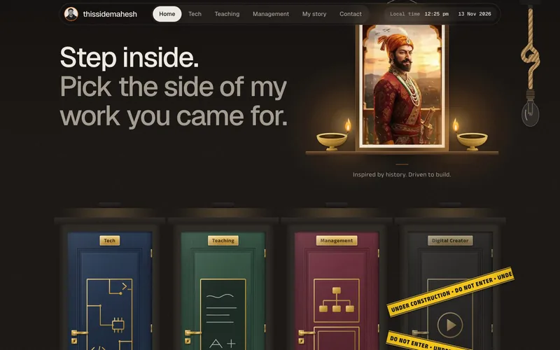
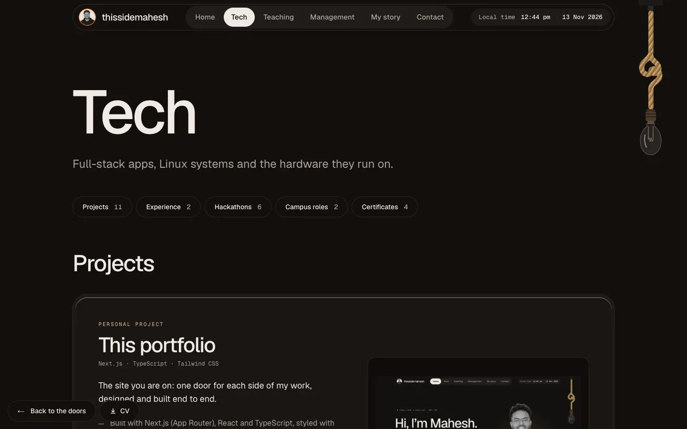

<p align="center">
  
</p>

<h1 align="center">Mahesh Namdev Khandebharad: Portfolio</h1>

A personal portfolio for a Computer Science and Engineering student who works across **tech**, **teaching** and **management**. Every visitor walks through one of three doors, each leading to a page of real projects, roles and certificates. A fourth door, Digital Creator, is locked for now.

**Live site:** [thissidemahesh.in](https://thissidemahesh.in)

| Home (dark) | Home (light) |
| --- | --- |
|  |  |

| The doors and the framed portrait | Tech |
| --- | --- |
|  |  |

## What is in it

- **Home:** a greeting with a spiral-bound flip calendar of roles (with a pause button), a "Step inside" hallway with four doors, a framed portrait, a "My story" timeline and a contact band.
- **Tech** (`/tech`): 25 cards in five sections: Projects, Experience, Hackathons, Campus roles and Certificates, with jump links.
- **Teaching** (`/teaching`) and **Management** (`/management`): workshops and training, recruitment drives, admissions outreach and student events.
- **Download CV:** a button in the hero, at the bottom left of the door pages and in the footer.
- Every card has a real screenshot, logo or certificate, or a small drawn emblem, plus links to the project's GitHub page and to the matching LinkedIn posts.

### Design and motion

- Warm, minimal look with a **light and a dark theme**. The theme follows the system and can be switched with the rope lamp.
- Doors are drawn in CSS and SVG. Opening a door plays a short walk-through, and switching between pages plays the same walk.
- Cards on all three door pages **stack as you scroll** (CSS `position: sticky`). A card is pinned only if it fits the window, so phones and short screens scroll normally.
- **Dark mode lights the two brass diyas** beside the portrait: one CSS token (`--diya-lit`) drives the flame, the glow and the light on the frame, so no JavaScript reads the theme.
- Every animation uses `transform` or `opacity` and is skipped or simplified under `prefers-reduced-motion`.

## Tech stack

| | |
| --- | --- |
| Framework | [Next.js](https://nextjs.org) 16.4.5 (App Router, Cache Components, Turbopack) |
| UI | React 19.3.1, TypeScript 5.9, Tailwind CSS 4.3 |
| Fonts | `next/font`: Geist and Geist Mono for the site; Anek Latin and Anek Devanagari for the door set and one line (all self-hosted) |
| Images | `next/image`, WebP, fixed dimensions (no layout shift) |
| Tooling | pnpm 12, ESLint 9, Node 22 or newer |

There are no runtime dependencies besides Next.js and React, and no third-party scripts, fonts or trackers.

## Getting started

```bash
pnpm install
pnpm dev          # http://localhost:3000
```

| Script | What it does |
| --- | --- |
| `pnpm dev` | Development server |
| `pnpm build` | Content guard, then production build |
| `pnpm start` | Serve the production build |
| `pnpm lint` | ESLint |
| `pnpm typecheck` | Generates route types, then `tsc --noEmit` |
| `pnpm check:content` | Runs only the content guard |
| `pnpm feedback` | Prints on-page review comments saved by the development-only comment tool |

`pnpm photo` and `pnpm cutout` prepare the portrait from a private source folder (`content/source`) that is not part of this repository.

Optional environment variable (copy `.env.example` to `.env.local`): `NEXT_PUBLIC_SITE_URL`, the canonical address used for links, the sitemap and the share image.

## Project structure

```
app/                 Routes: home, /tech, /teaching, /management, share image, robots, sitemap
components/
  home/              Hero, flip calendar, doors, portrait with diyas, story, contact band
  door-page/         Door pages: stacked cards, door walk transitions
  site/              Header, footer, opening animation, mobile menu
  theme/             Theme script, toggle, rope lamp
  ui/                Small shared pieces
lib/
  door-pages.ts      Every card on the three door pages
  data.ts            Doors, story timeline, contact options
  site.ts            Name, social links, CV file
public/
  images/            Portrait, card pictures, logos, drawn emblems
  *.pdf              The Master CV
scripts/             Content guard, photo tools, source for the drawn emblems
docs/                Product notes, design record, plan, screenshots
```

To add or change a card, edit `lib/door-pages.ts`; to change the story, edit `lib/data.ts`.

## Quality

Measured on a production build (Lighthouse, mobile):

| Page | Performance | Accessibility | Best practices | SEO |
| --- | --- | --- | --- | --- |
| Home | 99 | 100 | 100 | 100 |
| Tech, Teaching, Management | 100 | 100 | 100 | 100 |

- Largest Contentful Paint about 0.9 s and layout shift 0. Frame time stays at 60 fps with the diyas lit, while scrolling.
- Accessibility: skip link, landmarks, one `h1` per page, descriptive alt text, 44 px targets, visible focus, keyboard-operable controls, a pause button for the moving calendar and full reduced-motion support.
- **Content guard** (`scripts/check-content.mjs`): the build fails if the source contains placeholders, phone numbers, a date of birth, scores or percentages, or wording the owner has ruled out.

## Security

- Production responses carry a Content Security Policy limited to the site's own origin, HSTS, `X-Content-Type-Options`, a strict Referrer Policy, a Permissions Policy that switches off camera, microphone, location and payment, `frame-ancestors 'none'`, and a cross-origin opener policy.
- No forms, accounts or user input, and no secrets in the code. Contact is by email link only.
- The development-only review tool and its API route do not exist in production (the route answers 404).
- All outside links open with `rel="noopener noreferrer"`. Pictures carry no metadata.
- `pnpm audit --prod` reports no known vulnerabilities in what the deployed site ships. A full `pnpm audit` currently flags four advisories in development-only tools (`sharp`, used by the local photo script, and `minimatch`, pulled in by the linter); none of them are part of the deployed site.

## Deployment

Deployed on [Vercel](https://vercel.com) from the `main` branch. The site is served on [thissidemahesh.in](https://thissidemahesh.in), and `www.thissidemahesh.in` redirects to it. `NEXT_PUBLIC_SITE_URL` is set to `https://thissidemahesh.in` for the Production environment in the Vercel project settings, so the sitemap, robots file and share image use that address. A change to that setting needs a redeploy, because the value is fixed when the site is built.

## Documentation

- [`docs/PRD.md`](docs/PRD.md): what the site says, where every fact comes from, and the content rules.
- [`docs/DESIGN.md`](docs/DESIGN.md): the design record, one section for each decision, fix and audit.
- [`docs/PLAN.md`](docs/PLAN.md): the build plan.

## A note on privacy

The Master CV in `public/` is published as supplied, with the details it contains. Everything else on the site follows the content guard: no phone number, address, date of birth or scores.

## Copyright

© Mahesh Namdev Khandebharad. This is a personal portfolio. The text, pictures, logos, certificates and the CV are not licensed for reuse; please ask first. Organisation and project logos belong to their owners.

## Contact

[LinkedIn](https://www.linkedin.com/in/maheshkhandebharad/) · [GitHub](https://github.com/ThisSideMahesh) · [X](https://x.com/ThissideMahesh) · [Instagram](https://www.instagram.com/thisside_mahesh/) · thissidemahesh@gmail.com
